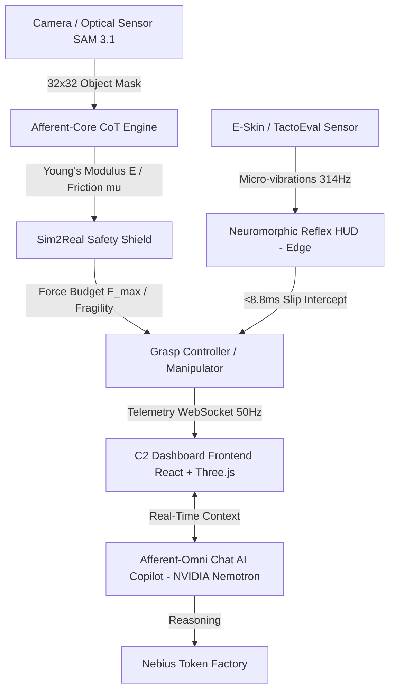

# 🛸 Afferent-Omni — Causal Vision-to-Touch Prior & C2 Control Dashboard
> **NASA/ESA-Grade Somatosensorial Robotics Control & Telemetry System**

[](https://github.com/raulrodriguezmesia-blip/afferent-omni)
[](LICENSE)
[](https://github.com/raulrodriguezmesia-blip/afferent-omni)
[](https://github.com/raulrodriguezmesia-blip/afferent-omni)
[](https://build.nvidia.com)
[](https://nebius.com)

> *"Robots see, but do not feel. Afferent gives them the intuition of touch."*

**Afferent-Omni** is an industrial- and aerospace-grade real-time Command & Control (C2) dashboard framework. Its mission is to endow robotic manipulators with a **tactile intuition based on a causal Vision-to-Touch Prior**.

The platform fuses cutting-edge multimodal perception (*Meta SAM 3.1, Muse Spark, Muse Wonder, Muse Image*) with advanced tribological physics and edge closed-loop computing at **50 Hz**, enabling dexterous manipulation of fragile components, biological tissues, and geological samples without structural failure risk or manual recalibration.

---

## ⚡ NVIDIA Model Integration

This project is built for the **Nebius x NVIDIA Global AI Hackathon** (Physical AI Track) and integrates **NVIDIA Nemotron 3 Super 120B** via **Nebius Token Factory** as the reasoning engine for the AI copilot.

### How NVIDIA Models Are Used

| NVIDIA Model | Usage in Afferent-Omni | Endpoint |
|---|---|---|
| **Nemotron 3 Super 120B** | Real-time reasoning over tactile telemetry JSON. Provides safety assessments, material analysis, and operational recommendations. | Nebius Token Factory (`/v1/chat/completions`) |
| **Meta SAM 3.1** | Object segmentation and 32×32 spatial contact grid construction | Meta Model API |
| **Meta Muse Spark/Wonder/Image** | Material inference, tribological property estimation, image analysis | Meta Model API |

### Why Nemotron?

Unlike static keyword-matching responses, **NVIDIA Nemotron** performs genuine reasoning over live telemetry data:
- Analyzes force budgets, uncertainty scores, and material properties
- Provides safety assessments with physical implications
- Suggests operational adjustments based on real-time sensor data
- Explains tribological physics in natural language

### Nebius Token Factory Integration

The backend uses Nebius Token Factory as the primary LLM provider:

```python
NEBIUS_BASE_URL = "https://api.tokenfactory.nebius.ai/v1/"
NEBIUS_MODEL = "nvidia/nemotron-3-super-120b-a12b"

# Priority: Nemotron → OpenAI → Anthropic → Keyword fallback
async def _try_nemotron(query, context):
    api_key = os.getenv("NEBIUS_API_KEY")
    # Calls Nebius Token Factory with telemetry context as system prompt
    ...
```

**Environment variables:**
```bash
NEBIUS_API_KEY=your-nebius-api-key
NEBIUS_BASE_URL=https://api.tokenfactory.nebius.ai/v1/
NEBIUS_MODEL=nvidia/nemotron-3-super-120b-a12b
```

---

## ⚡ Why Afferent-Omni Is Different (Análisis Comparativo de Mercado)

A diferencia de los sensores táctiles aislados o los simuladores convencionales, **Afferent-Omni** actúa como un puente de software de extremo a extremo (*End-to-End*) que integra percepción visual previa al contacto, física tribológica consciente de la fragilidad y arcos reflejos en el borde.

| Dimension / Capability | GelSight / GelSight Mini | Meta DIGIT / TactileX | NVIDIA Isaac Sim / Gym | ROS 2 + MoveIt | 🛸 **Afferent-Omni** |
| :--- | :---: | :---: | :---: | :---: | :---: |
| **Causal Vision-to-Touch Integration** | ❌ (Tactile image only) | ❌ (E-skin sensor only) | ⚠️ (Requires plugins) | ❌ (Control middleware) | **✅ Yes (Prior with SAM 3.1 & Muse)** |
| **Dynamic Safety Gating ($F_{\text{max}}$)** | ❌ (Static limits) | ❌ (Static limits) | ⚠️ (Fixed parameters) | ❌ (Custom dev required) | **✅ Yes (Sim2Real Safety Shield)** |
| **Neuromorphic Edge Reflex Arc** | ❌ | ❌ | ❌ (High visual loop) | ⚠️ (RT driver dependent) | **✅ Yes (<10 ms Edge Latency)** |
| **Acoustic Stick-Slip Spectrogram (E-Skin)** | ❌ | ❌ | ❌ | ❌ | **✅ Yes (12-bin harmonic analysis)** |
| **50 Hz Glassmorphism 3D C2 Dashboard** | ❌ (Flat logs / SDK) | ❌ (Python utilities only) | ⚠️ (Heavy sim GUI) | ⚠️ (Traditional RViz2) | **✅ Yes (Three.js + WebSockets)** |
| **Specialized Conversational AI Copilot** | ❌ | ❌ | ❌ | ❌ | **✅ Yes (NVIDIA Nemotron via Nebius)** |

---

## 🏗️ Arquitectura del Sistema



### 🛠️ Technology Stack
- **Backend & Telemetry:** FastAPI (Python 3.10+), Uvicorn, WebSockets for bidirectional 50 Hz streaming, NLP router with real-time contextualization.
- **Frontend UI/UX:** React 18, Vite, TypeScript, Tailwind CSS, Dark Glassmorphism (Ethos-Style UI), decoupled interactive components (CustomDropdown).
- **3D Visualization & Physics:** Three.js, React Three Fiber, real-time 2D/3D gel deformation heatmaps, dynamic HSL glow spheres and shear force ArrowHelpers.
- **AI Model Stack:** Meta SAM 3.1, Meta Muse Spark, Meta Muse Wonder, Meta Muse Image, **NVIDIA Nemotron 3 Super 120B** (via Nebius Token Factory).
- **Deployment:** Docker, Docker Compose, Nebius AI Cloud.

---

## 🚀 Key Dashboard Modules

### 1. Tactile CoT & Afferent-Core
- High-fidelity $32 \times 32$ spatial contact grid construction via SAM 3.1.
- Tribological Chain-of-Thought reasoning to estimate Young's Modulus ($E$), static friction coefficient ($\mu$), and shear stress concentration zones.

### 2. Sim2Real Safety Shield
- **Adaptive Force Budget:** Dynamic computation of $F_{\text{max}}$, $F_{\text{recommended}}$, and $F_{\text{slip\_min}}$.
- **Uncertainty Gating ($U_{\text{th}}$):** Automatic safe grasp authorization (`AUTHORIZED_SAFE_GRASP`) when visual/tactile uncertainty stays below the configured margin.

### 3. Neuromorphic Reflex HUD (Edge Computing)
- Neuromorphic reflex arc processed directly at the edge with ultra-low latency (8.8 ms).
- Preventive detection and interception of micro-slips before relying on the central vision loop.

### 4. Multi-Digit Selector & Manipulator (NASA/JPL Style)
- Topological grasp telemetry and control for multi-digit contact (thumb, index, middle, full hand).
- Continuous computation of Center of Pressure ($CoP$) and Torque Balance Index ($TBI$).

### 5. 3D Gel Deformation Viewer (Three.js)
- Real-time elastomer deformation mesh.
- 60 FPS rendering with HSL glow spheres indicating pressure and directional shear force vectors.

### 6. Acoustic-Slip Spectrogram (E-Skin)
- Monitoring of stick-slip micro-vibrations on electronic skin (E-Skin).
- Dominant frequency (e.g., 314.3 Hz) and 12-bin harmonic spectrum.

### 7. Afferent-Omni Chat AI Copilot
- Fully integrated somatosensorial conversational assistant connected to live telemetry endpoints and state.
- **Powered by NVIDIA Nemotron 3 Super 120B** via Nebius Token Factory for real-time reasoning over tactile telemetry.
- Natural language responses in English with technical precision.

### 8. Material Calibration (Bayesian)
- Micro-probe calibration (0.2 N) with Bayesian-inspired heuristics.
- Refines Young's Modulus, friction coefficient, and shear limit for unknown materials.

### 9. Compliance & Safety Certification
- ISO 10218-1, ISO/TS 15066, IEC 61508, Sim2Real, TactoEval conformity validation.
- Automated pass/fail report with score percentage.

### 10. Anomaly Detection & Predictive Maintenance
- Statistical anomaly detection (force spikes, uncertainty drift, latency degradation, stick-slip energy, actuator drift).
- Risk level classification (low, medium, high).

### 11. Zero-Shot Grasp Planning
- Vision-prior-based grasp strategy selection (precision pinch, power grasp, gentle cradle, soft pinch, adaptive).
- Predicted force, contact points, and confidence without prior training data.

### 12. Session Replay & Data Logging
- Frame-by-frame playback of recorded telemetry at 50 Hz.
- Export full session data as JSON/CSV for post-mortem analysis and model training.

---

## 🌍 Casos de Uso Industriales de Alto Impacto

- 🛸 **Orbital & Aerospace Maintenance (NASA / ESA):** Dexterous manipulation of unconsolidated regolith, fragile geological samples, and space components in microgravity, superando las limitaciones de latencia de teleoperación.
- 🩺 **Medical Robotics & Precision Surgery:** Protection of sensitive organic tissues in minimally invasive procedures. El arco reflejo sub-milisegundo previene rasgaduras adaptando la presión al instante.
- 🤖 **High-Precision Industrial Assembly (Tesla / EV Manufacturing):** Zero-Shot automation for handling lithium-ion battery cells, optical lenses, and tempered glass without manual recalibration.
- 🦿 **Bionic Prosthetics & E-Skin Research:** Translation engine between physical friction stimuli and high-frequency neural feedback signals.

---

## 💻 Instalación y Despliegue Rápido

### Prerrequisitos
- Node.js v18+
- Python 3.10+
- Git
- Docker (opcional, para despliegue en Nebius)

### 1. Clonar el Repositorio
```bash
git clone https://github.com/raulrodriguezmesia-blip/afferent-omni.git
cd afferent-omni
```

### 2. Configurar y Levantar el Backend (FastAPI)
```bash
# Entrar a la carpeta backend
cd apps/api

# Crear y activar entorno virtual
python -m venv venv
# En Windows:
.\venv\Scripts\activate
# En Linux/macOS:
source venv/bin/activate

# Instalar dependencias
pip install -r requirements.txt

# Configurar variables de entorno (opcional, para NVIDIA Nemotron)
export NEBIUS_API_KEY=your-nebius-api-key
export NEBIUS_BASE_URL=https://api.tokenfactory.nebius.ai/v1/
export NEBIUS_MODEL=nvidia/nemotron-3-super-120b-a12b

# Iniciar servidor FastAPI (Puerto 8002)
uvicorn app.main:app --reload --port 8002
```

### 3. Configurar y Levantar el Frontend (React + Vite)
```bash
# En una nueva terminal, ir a la raíz del proyecto / frontend
cd apps/web

# Instalar dependencias
npm install

# Iniciar servidor de desarrollo Vite (Puerto 5173)
npm run dev
```

Accede al dashboard desde tu navegador en: **http://localhost:5173**

Standalone showcase (sin backend): **http://localhost:5173/showcase.html**

### 4. Despliegue con Docker (Nebius AI Cloud)
```bash
# Configurar variables de entorno
cp .env.example .env
# Editar .env con tu NEBIUS_API_KEY

# Levantar toda la stack
docker-compose up -d

# Verificar
curl http://localhost:8000/health
curl http://localhost:8000/api/v1/model-status
```

---

## 📄 Licencia

Este proyecto se distribuye bajo la Licencia MIT. Consulta el archivo LICENSE para obtener más información.

Desarrollado con pasión para la robótica diestra de próxima generación. 🚀

---

### Physical AI Track — Nebius x NVIDIA Global AI Hackathon

**Afferent-Omni** compite en el **Physical AI Track** del Nebius x NVIDIA Global AI Hackathon porque:

1. **Embodied Intelligence:** Sistema de manipulación robótica que sense y actúa en el mundo real a través de telemetría táctil en tiempo real.
2. **NVIDIA Models:** Integra **NVIDIA Nemotron 3 Super 120B** via Nebius Token Factory como motor de razonamiento para el AI copilot.
3. **Nebius Infrastructure:** Desplegable en Nebius AI Cloud con Docker Compose. Usa Nebius Token Factory para inferencia de Nemotron.
4. **Real-World Application:** Manipulación de componentes frágiles (vidrio, tejidos, muestras geológicas) con seguridad Sim2Real.
5. **Open Source:** Licencia MIT, repositorio público, documentación completa.

**Demo Video:** [Link to 3-minute demo video]

**Key Application Modules (Physical AI):**
- 3D Gel Deformation Viewer (Three.js) — visualización de contacto en tiempo real
- Sim2Real Safety Shield — gating dinámico de fuerza con incertidumbre
- Neuromorphic Reflex HUD — arco reflejo en el borde (<10ms)
- Multi-Digit Topology — control de agarre multi-dígito estilo NASA JPL
- Acoustic-Slip Spectrogram — análisis de micro-vibraciones stick-slip
- Material Calibration — calibración bayesiana de materiales desconocidos
- Compliance Report — validación ISO 10218-1, ISO/TS 15066, IEC 61508
- Anomaly Detection — mantenimiento predictivo con detección estadística
- Zero-Shot Grasp Planning — planificación de agarre sin datos de entrenamiento previos
- Session Replay — reproducción frame-by-frame de telemetría a 50 Hz
