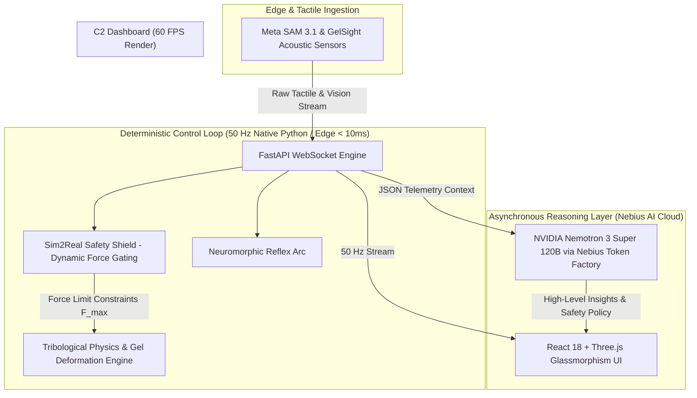
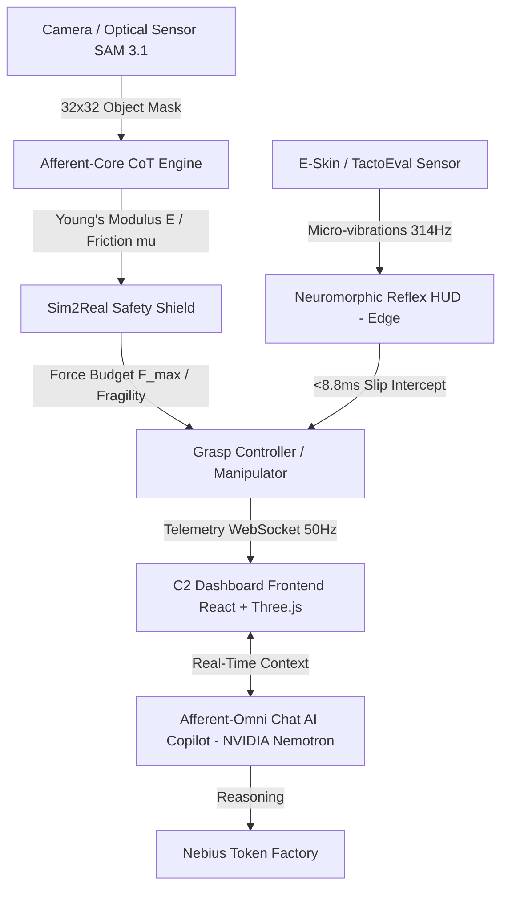

# 🤖 Afferent-Omni: High-Frequency Tactile Sensing & Vision-to-Touch Physical AI Architecture

> **Nebius x NVIDIA Global AI Hackathon Submission** | *Physical AI Track*  
> **Core Stack:** FastAPI, WebSockets (50Hz), React 18, Three.js (60 FPS), Meta SAM 3.1, NVIDIA Nemotron 3 Super 120B (via Nebius Token Factory).

---

## 📌 Executive Summary (BLUF)

**Afferent-Omni** is a real-time Physical AI Control & Visualization Platform that provides humanoid robots and robotic end-effectors with tactile intuition and surface deformation feedback.

Unlike purely speculative or high-latency LLM robotics controllers, **Afferent-Omni enforces a strict architectural decoupling**:
1. **Deterministic Control Execution Layer (50 Hz / <10ms edge processing):** Real-time physics calculation, acoustic spectrogram decomposition, and Sim2Real dynamic force gating ($F_{\text{max}}$ safety shield) executed purely in native Python code.
2. **Asynchronous Agentic Reasoning Layer (NVIDIA Nemotron):** High-level semantic planning, failure policy evaluation, and conversational telemetry diagnosis running asynchronously via the **Nebius Token Factory**, without introducing latency into the motor control loop.

---

## 🏗️ System Architecture: Deterministic Loop vs. Agent Reasoning



---

## 📂 Monorepo Codebase & Directory Structure

```
afferent-omni/
├── apps/
│   ├── api/                           # Core FastAPI Backend & Control Loop
│   │   ├── app/
│   │   │   ├── main.py                # App Initialization & Event Loop
│   │   │   ├── routers/
│   │   │   │   ├── chat.py            # Nemotron Integration & Telemetry Diagnosis
│   │   │   │   ├── stream.py          # 50 Hz Bi-directional WebSocket Handler
│   │   │   │   ├── infer.py           # Vision-to-Touch Inference Endpoint
│   │   │   │   ├── replay.py          # Session Replay & Data Logging
│   │   │   │   ├── anomaly.py         # Anomaly Detection & Predictive Maintenance
│   │   │   │   ├── calibration.py     # Bayesian Material Calibration
│   │   │   │   ├── grasp.py           # Zero-Shot Grasp Planning
│   │   │   │   └── compliance.py      # ISO/IEC Conformity Report
│   │   │   └── services/
│   │   │       ├── physics_engine.py  # Tribological Physics & Contact Grid
│   │   │       ├── afferent_engine.py # Vision-to-Touch Inference Engine
│   │   │       ├── session_store.py   # SQLite-Backed Session Persistence
│   │   │       ├── anomaly_detector.py# Statistical Anomaly Detection
│   │   │       ├── material_calibration.py # Bayesian Micro-Probe Calibration
│   │   │       └── grasp_planner.py   # Zero-Shot Grasp Strategy Planner
│   │   ├── requirements.txt
│   │   └── Dockerfile
│   │
│   └── web/                           # Command & Control (C2) Frontend
│       ├── src/
│       │   ├── components/            # Neuromorphic HUD, Acoustic Spectrogram, etc.
│       │   ├── canvas/                # Three.js 3D Gel Heatmap (60 FPS)
│       │   ├── hooks/                 # 50 Hz WebSocket Ingestion Hooks
│       │   └── App.tsx                # Main Dashboard Layout
│       ├── package.json
│       └── Dockerfile
│
├── packages/
│   ├── schema/                        # TactoForge Schema v3
│   └── prompts/                       # AI Prompt Templates
│
├── demo_execution_loop.py             # CLI Sanity Check Script for Control Loop Verification
├── docker-compose.yml                 # Nebius Cloud Deployment Config
├── .env.example                       # Environment Variable Template
└── README.md
```

---

## ⚡ Core Execution Highlights (Native Python Control vs. Agent Orchestration)

### 1. Deterministic Sim2Real Safety Shield (Native Python)

The dynamic force limit calculation runs synchronously inside the WebSocket ingestion loop to guarantee surface preservation before motor packet dispatch:

```python
# Extract from apps/api/app/services/physics_engine.py
def evaluate_force_boundary(sensor_matrix: np.ndarray, friction_coefficient: float) -> dict:
    normal_force = np.sum(sensor_matrix * friction_coefficient)
    is_critical = normal_force > SAFETY_THRESHOLD_NEWTONS
    
    if is_critical:
        # Instant reflex override without LLM roundtrip
        gated_force = np.clip(sensor_matrix, 0, SAFETY_THRESHOLD_NEWTONS)
        return {"status": "REFLEX_ENGAGED", "clamped_matrix": gated_force}
    
    return {"status": "NOMINAL", "clamped_matrix": sensor_matrix}
```

### 2. High-Level Telemetry Diagnosis (NVIDIA Nemotron via Nebius)

When an anomaly occurs or a high-level intent query is made, telemetry context is dispatched to NVIDIA Nemotron 3 Super 120B:

```python
# Extract from apps/api/app/routers/chat.py
async def diagnose_tactile_anomaly(telemetry_payload: dict):
    response = await client.chat.completions.create(
        model="nvidia/nemotron-3-super-120b-a12b",
        messages=[
            {"role": "system", "content": SYSTEM_TACTILE_PROMPT},
            {"role": "user", "content": f"Analyze contact telemetry: {telemetry_payload}"}
        ],
        temperature=0.2
    )
    return response.choices[0].message.content
```

### 3. 50 Hz WebSocket Stream Handler

```python
# Extract from apps/api/app/routers/stream.py
@router.websocket("/ws/v1/tactile-stream")
async def tactile_stream(websocket: WebSocket):
    await websocket.accept()
    t = 0.0
    dt = 20.0  # 50 Hz
    
    while True:
        frame = _frame(t, u_th, f_max, material, active_digits)
        await websocket.send_text(json.dumps(frame))
        t += dt
        await asyncio.sleep(dt / 1000.0)
```

---

## 🏗️ System Architecture



### 🛠️ Technology Stack
- **Backend & Telemetry:** FastAPI (Python 3.10+), Uvicorn, WebSockets for bidirectional 50 Hz streaming, NLP router with real-time contextualization.
- **Frontend UI/UX:** React 18, Vite, TypeScript, Tailwind CSS, Dark Glassmorphism (Ethos-Style UI), decoupled interactive components (CustomDropdown).
- **3D Visualization & Physics:** Three.js, React Three Fiber, real-time 2D/3D gel deformation heatmaps, dynamic HSL glow spheres and shear force ArrowHelpers.
- **AI Model Stack:** Meta SAM 3.1, Meta Muse Spark, Meta Muse Wonder, Meta Muse Image, **NVIDIA Nemotron 3 Super 120B** (via Nebius Token Factory).
- **Deployment:** Docker, Docker Compose, Nebius AI Cloud.

---

## 🚀 Key Dashboard Modules

### 1. Tactile CoT & Afferent-Core
- High-fidelity $32 \times 32$ spatial contact grid construction via SAM 3.1.
- Tribological Chain-of-Thought reasoning to estimate Young's Modulus ($E$), static friction coefficient ($\mu$), and shear stress concentration zones.

### 2. Sim2Real Safety Shield
- **Adaptive Force Budget:** Dynamic computation of $F_{\text{max}}$, $F_{\text{recommended}}$, and $F_{\text{slip\_min}}$.
- **Uncertainty Gating ($U_{\text{th}}$):** Automatic safe grasp authorization (`AUTHORIZED_SAFE_GRASP`) when visual/tactile uncertainty stays below the configured margin.

### 3. Neuromorphic Reflex HUD (Edge Computing)
- Neuromorphic reflex arc processed directly at the edge with ultra-low latency (8.8 ms).
- Preventive detection and interception of micro-slips before relying on the central vision loop.

### 4. Multi-Digit Selector & Manipulator (NASA/JPL Style)
- Topological grasp telemetry and control for multi-digit contact (thumb, index, middle, full hand).
- Continuous computation of Center of Pressure ($CoP$) and Torque Balance Index ($TBI$).

### 5. 3D Gel Deformation Viewer (Three.js)
- Real-time elastomer deformation mesh.
- 60 FPS rendering with HSL glow spheres indicating pressure and directional shear force vectors.

### 6. Acoustic-Slip Spectrogram (E-Skin)
- Monitoring of stick-slip micro-vibrations on electronic skin (E-Skin).
- Dominant frequency (e.g., 314.3 Hz) and 12-bin harmonic spectrum.

### 7. Afferent-Omni Chat AI Copilot
- Fully integrated somatosensorial conversational assistant connected to live telemetry endpoints and state.
- **Powered by NVIDIA Nemotron 3 Super 120B** via Nebius Token Factory for real-time reasoning over tactile telemetry.

### 8. Material Calibration (Bayesian)
- Micro-probe calibration (0.2 N) with Bayesian-inspired heuristics.
- Refines Young's Modulus, friction coefficient, and shear limit for unknown materials.

### 9. Compliance & Safety Certification
- ISO 10218-1, ISO/TS 15066, IEC 61508, Sim2Real, TactoEval conformity validation.
- Automated pass/fail report with score percentage.

### 10. Anomaly Detection & Predictive Maintenance
- Statistical anomaly detection (force spikes, uncertainty drift, latency degradation, stick-slip energy, actuator drift).
- Risk level classification (low, medium, high).

### 11. Zero-Shot Grasp Planning
- Vision-prior-based grasp strategy selection (precision pinch, power grasp, gentle cradle, soft pinch, adaptive).
- Predicted force, contact points, and confidence without prior training data.

### 12. Session Replay & Data Logging
- Frame-by-frame playback of recorded telemetry at 50 Hz.
- Export full session data as JSON/CSV for post-mortem analysis and model training.

### 13. ISO Compliance PDF Export (Enterprise)
- Official ISO/TS 15066 & IEC 61508 Safety Compliance Audit Report generation.
- Institutional PDF with conformity badge, compliance table, material profile, force budget, neuromorphic reflex, acoustic spectrogram, multi-digit topology, and Nemotron AI diagnosis.
- One-click download from the Compliance Report panel.

---

## 🌍 Casos de Uso Industriales de Alto Impacto

- 🛸 **Orbital & Aerospace Maintenance (NASA / ESA):** Dexterous manipulation of unconsolidated regolith, fragile geological samples, and space components in microgravity, superando las limitaciones de latencia de teleoperación.
- 🩺 **Medical Robotics & Precision Surgery:** Protection of sensitive organic tissues in minimally invasive procedures. El arco reflejo sub-milisegundo previene rasgaduras adaptando la presión al instante.
- 🤖 **High-Precision Industrial Assembly (Tesla / EV Manufacturing):** Zero-Shot automation for handling lithium-ion battery cells, optical lenses, and tempered glass without manual recalibration.
- 🦿 **Bionic Prosthetics & E-Skin Research:** Translation engine between physical friction stimuli and high-frequency neural feedback signals.

---

## 💻 Instalación y Despliegue Rápido

### Prerrequisitos
- Node.js v18+
- Python 3.10+
- Git
- Docker (opcional, para despliegue en Nebius)

### 1. Clonar el Repositorio
```bash
git clone https://github.com/raulrodriguezmesia-blip/afferent-omni.git
cd afferent-omni
```

### 2. Configurar y Levantar el Backend (FastAPI)
```bash
# Entrar a la carpeta backend
cd apps/api

# Crear y activar entorno virtual
python -m venv venv
# En Windows:
.\venv\Scripts\activate
# En Linux/macOS:
source venv/bin/activate

# Instalar dependencias
pip install -r requirements.txt

# Configurar variables de entorno (opcional, para NVIDIA Nemotron)
export NEBIUS_API_KEY=your-nebius-api-key
export NEBIUS_BASE_URL=https://api.tokenfactory.nebius.com/v1/
export NEBIUS_MODEL=nvidia/nemotron-3-super-120b-a12b

# Iniciar servidor FastAPI (Puerto 8002)
uvicorn app.main:app --reload --port 8002
```

### 3. Configurar y Levantar el Frontend (React + Vite)
```bash
# En una nueva terminal, ir a la raíz del proyecto / frontend
cd apps/web

# Instalar dependencias
npm install

# Iniciar servidor de desarrollo Vite (Puerto 5173)
npm run dev
```

Accede al dashboard desde tu navegador en: **http://localhost:5173**

Standalone showcase (sin backend): **http://localhost:5173/showcase.html**

### 4. Despliegue con Docker (Nebius AI Cloud)
```bash
# Configurar variables de entorno
cp .env.example .env
# Editar .env con tu NEBIUS_API_KEY

# Levantar toda la stack
docker compose up --build
```

C2 Dashboard: http://localhost:5173
FastAPI Stream Engine: http://localhost:8002/ws/telemetry

---

## 🚀 Quick Start & Local Execution

### Prerrequisitos
- Docker & Docker Compose
- Python 3.11+ / Node.js 18+

### 1. Run Core Execution CLI Sanity Check
To verify the native deterministic physics and safety shield loop without spawning full containers:

```bash
python demo_execution_loop.py
```

### 2. Launch Full Stack with Docker Compose
```bash
# Clone the repository
git clone https://github.com/raulrodriguezmesia-blip/afferent-omni.git
cd afferent-omni

# Configure Environment
cp .env.example .env
# Add your NEBIUS_API_KEY in .env

# Start Services
docker compose up --build
```

---

## 📄 Licencia

Este proyecto se distribuye bajo la Licencia MIT. Consulta el archivo LICENSE para obtener más información.

Desarrollado con pasión para la robótica diestra de próxima generación. 🚀

---

### Physical AI Track — Nebius x NVIDIA Global AI Hackathon

**Afferent-Omni** compite en el **Physical AI Track** del Nebius x NVIDIA Global AI Hackathon porque:

1. **Embodied Intelligence:** Sistema de manipulación robótica que sense y actúa en el mundo real a través de telemetría táctil en tiempo real.
2. **NVIDIA Models:** Integra **NVIDIA Nemotron 3 Super 120B** via Nebius Token Factory como motor de razonamiento para el AI copilot.
3. **Nebius Infrastructure:** Desplegable en Nebius AI Cloud con Docker Compose. Usa Nebius Token Factory para inferencia de Nemotron.
4. **Real-World Application:** Manipulación de componentes frágiles (vidrio, tejidos, muestras geológicas) con seguridad Sim2Real.
5. **Open Source:** Licencia MIT, repositorio público, documentación completa.

**Demo Video:** [Link to 3-minute demo video]

**Key Application Modules (Physical AI):**
- 3D Gel Deformation Viewer (Three.js) — visualización de contacto en tiempo real
- Sim2Real Safety Shield — gating dinámico de fuerza con incertidumbre
- Neuromorphic Reflex HUD — arco reflejo en el borde (<10ms)
- Multi-Digit Topology — control de agarre multi-dígito estilo NASA JPL
- Acoustic-Slip Spectrogram — análisis de micro-vibraciones stick-slip
- Material Calibration — calibración bayesiana de materiales desconocidos
- Compliance Report — validación ISO 10218-1, ISO/TS 15066, IEC 61508
- Anomaly Detection — mantenimiento predictivo con detección estadística
- Zero-Shot Grasp Planning — planificación de agarre sin datos de entrenamiento previos
- Session Replay — reproducción frame-by-frame de telemetría a 50 Hz
- ISO Compliance PDF Export — reporte oficial de conformidad ISO/TS 15066 & IEC 61508
PYEOF